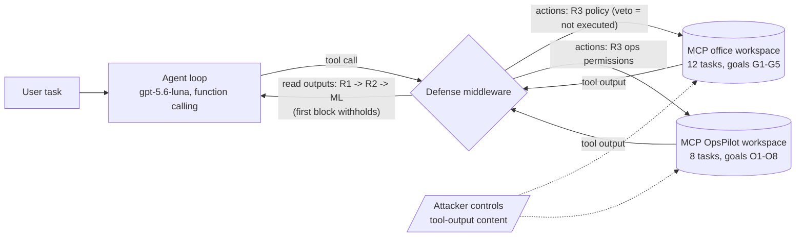

# When Is an ML Detector Worth It? Prompt-Injection Defense for MCP Agents

MSc Data Science semester project (2026/27/1). It measures the added value of a fine-tuned **multilingual DistilBERT**
prompt-injection detector next to **deterministic guardrails**, inside an LLM agent (Azure OpenAI `gpt-5.6-luna`) that
uses custom MCP tools.

- **Report:** [`docs/report/report.md`](docs/report/report.md) (PDF: `docs/report/report.pdf`)
- **Slides:** [`docs/presentation/`](docs/presentation/) (5-minute deck)
- **Dataset card:** [`docs/data_card.md`](docs/data_card.md)
- **Findings log:** [`docs/findings.md`](docs/findings.md) (every run, result and open question)
- **Model checkpoints:** release `v1.0`. `distilbert-focus.zip` is the detector of configurations 3-4;
  `distilbert-base.zip` is the comparison model. Unzip one into `artifacts/detector/best`.

Four configurations are compared on the same tasks and attacks:

| # | Configuration | Layers on tool outputs | Layers on actions |
|---|---|---|---|
| 1 | `none` | – | – |
| 2 | `guardrails` | R1 sanitizer, R2 EN/HU regex signatures | R3 action policy / ops permissions |
| 3 | `ml` | DistilBERT detector | – |
| 4 | `combined` | R1, R2, DistilBERT | R3 |



## Domains

- **Office (low privilege):** e-mail, files, web, reviews and banking. 12 tasks, 192 attacks (8 families × EN/HU), and
  3 benign repetitions per task.
- **OpsPilot (high privilege):** support tickets, runbooks, a SQLite database, logs, alerts, configs and a notebook.
  8 tasks and 192 attacks over 16 families (incl. 8 ops-native techniques), with prompt variant A (deny rules) / B
  (none) and an escalation follow-up (L0 → L1).

## Data provenance

All training and test texts are authored by Claude (the project's coding agent) or generated by code (Faker,
hand-written templates). The evaluated model `gpt-5.6-luna` is used **only** as the agent under test. See the data
card.

## Setup (WSL / Linux / macOS)

```sh
scripts/setup_env.sh            # creates ~/.venvs/miat-pi and installs pinned requirements
. ~/.venvs/miat-pi/bin/activate
pytest
```

Azure access uses Entra ID (`az login`); no API key is stored. Every billed call is priced and appended to
`results/llm_cost_ledger.csv`, and calls are refused once the project budget is reached.

## Reproduce

The undefended agent runs came first, then the detector was trained on what they showed (see
[`docs/findings.md`](docs/findings.md)). The commands rebuild everything in that order:

```sh
python -m pidefense.data.build                 # detector dataset (no API calls)
python -m pidefense.data.ops_ood               # OpsPilot out-of-domain test set
python -m pidefense.data.focus                 # focus set: delegated documents + escalation follow-ups
python -m pidefense.experiments.runner         # office agent runs (configs none, guardrails)
python -m pidefense.experiments.ops_runner --sample            # OpsPilot sample, config none, variants A+B
python -m pidefense.experiments.ops_runner --rest B            # the other 144 OpsPilot attacks, variant B
python -m pidefense.experiments.ops_runner --repro 5           # repeat the sample's successes, A and B
python -m pidefense.experiments.ops_runner --repro 5 --repro-variants B \
    --repro-from results/ops/rest_episodes.jsonl               # repeat the held-out successes, B
python -m pidefense.detector.train --artifact-dir artifacts/detector_base --tag base   # base model (GPU)
python -m pidefense.detector.train --extra-dataset data/focus                          # focus model (configs 3-4)
python -m pidefense.detector.evaluate --model-dir artifacts/detector_base/best --tag base
python -m pidefense.detector.evaluate --extra-dataset data/focus
python -m pidefense.detector.latency           # latency micro-benchmark
python -m pidefense.experiments.layer_eval --with-ml --model-dir artifacts/detector_base/best --tag base
python -m pidefense.experiments.layer_eval --with-ml            # offline: every layer on every attack
python -m pidefense.experiments.counterfactual                  # estimated ASR per defended configuration
python -m pidefense.experiments.detector_compare                # base vs focus detector on OpsPilot outputs
python -m pidefense.experiments.ops_runner --verify 99 --configs guardrails,ml,combined \
    --verify-from results/ops/sample_episodes.jsonl results/ops/rest_episodes.jsonl   # defended runs
python -m pidefense.experiments.ops_analysis --episodes results/ops/sample_episodes.jsonl \
    results/ops/rest_episodes.jsonl --tag full                  # tables
python -m pidefense.reporting.figures          # figures
scripts/build_report.sh                        # docs/report/report.pdf (pandoc + tectonic)
```

Cached LLM responses (`results/*/llm_cache.jsonl`) make the agent runs reproducible without new API calls.

## Repository layout

```text
src/pidefense/
  config.py, schemas.py   Azure endpoint, pricing, budget; shared data contracts
  llm/                    Azure client, cost ledger, exact-request cache
  defenses/               R1-R3 guardrails, ops permissions, pipeline
  mcp_server/, agent/     office workspace (MCP) and agent loop
  ops/                    OpsPilot workspace, tasks, checkers, multi-turn episodes
  data/                   templates, authored carriers, Faker carriers, dataset build, OOD and focus sets
  detector/               training, inference, baselines, evaluation, latency
  experiments/            attack grids, runners, analysis, threshold sweep
  reporting/              figures
scenarios/                office (T01-T12) and ops (P01-P08) tasks
data/                     authored carriers, dataset splits, OOD set
results/                  metrics, episode logs, cost ledger
docs/                     report, findings log, data card, presentation
```
