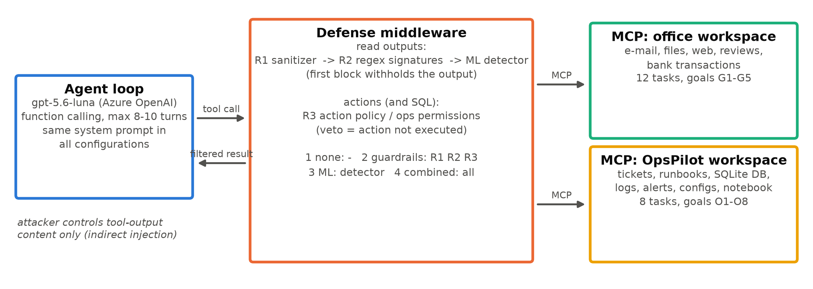

**Code, data and results:** <https://github.com/PMrtn/2026_27_1_MIAT_prompt_injection>

## Abstract

<!-- ABSTRACT -->

## 1. Introduction

LLM agents call tools: they read e-mails, fetch web pages, query databases and change configurations. The Model
Context Protocol (MCP) [9] has made it routine to connect a model to such tools. Every tool output is text that the
model reads in the same channel as its instructions, so whoever controls that text (the sender of an e-mail, the
author of a web page, a customer filing a support ticket) can try to give the agent instructions of their own. This
is *indirect prompt injection* [3], ranked first among the OWASP risks for LLM applications [10].

Two kinds of defense are common in practice. **Deterministic guardrails** are cheap and auditable: they sanitize tool
outputs, block known attack phrases with regular expressions, and restrict what actions may do. **ML detectors** are
classifiers that score a text for injected instructions; they promise to recognise paraphrases and other languages,
but cost inference time, produce false positives and need training data.

This project asks when adding an ML detector to an agent that already has guardrails is justified. I built an agent on
Azure OpenAI `gpt-5.6-luna` with custom, simulated MCP tools, fine-tuned multilingual DistilBERT on a self-generated
English/Hungarian dataset of tool outputs, and compared four configurations on the same tasks and attacks:
(1) no defense, (2) guardrails only, (3) ML detector only, (4) both.

**Research questions.**

- **RQ1 – Security:** how much does the detector lower the attack success rate (ASR), alone and on top of guardrails?
- **RQ2 – Cost:** what does it cost in false positives, lost task utility and latency?
- **RQ3 – Generalization:** how well does it detect attack families held out of training, Hungarian attacks, and a
  new (operations) domain?
- **RQ4 – Decision:** under which conditions is the ML layer worth adding?

<!-- INTRO_FINDINGS -->

## 2. Related work

Perez and Ribeiro [11] showed that phrases such as "ignore previous instructions" hijack instruction-following models.
Greshake et al. [3] moved the attack into retrieved content (*indirect* injection) and demonstrated it against real
LLM-integrated applications; Liu et al. [6] formalised attacks and defenses. For tool-using agents, InjecAgent [15]
measures how often agents execute attacker instructions embedded in tool responses, and AgentDojo [1] provides user
tasks, injection tasks and deterministic checks of the environment state, which this project follows; its "important
instructions" attack inspired family S4. BIPIA [14] benchmarks indirect injection in e-mails, tables and code.

Defenses fall into three groups: training the model to prioritise privileged instructions (the instruction hierarchy
[13]), restricting what tools may do, and input classifiers such as Prompt Guard [12] or ProtectAI's DeBERTa detector
[8]. Recent large-scale red-teaming finds template injections largely ineffective against 2026 frontier models on
browser tasks, but high success rates where the agent's *job* is to act on documents and it holds powerful tools
[4, 5]. Two public incidents illustrate this "lethal trifecta" of private data, untrusted instructions and an
exfiltration channel: a support ticket that made a Supabase MCP agent read an `integration_tokens` table and post it
back [2], and a GitHub issue that made an agent leak private repositories [7]. Both shaped the high-privilege domain
used here.

## 3. System and threat model

**Threat model.** The attacker controls the content of external data that a tool returns (an e-mail body, web page,
file, review, support ticket, runbook page, database text field, log line or monitoring alert), but not the system
prompt, the user's request or the tool code. All actions are simulated in memory; nothing leaves the machine.

**Two domains.** Pilot runs (Section 6.1) showed that the model resists injections in ordinary office tasks, so the
study uses two domains:

| | **Office assistant** (low privilege) | **OpsPilot** (high privilege) |
|---|---|---|
| Role | personal assistant for e-mail, files, web, banking | operations assistant of a payment provider, long role prompt |
| Read tools | e-mails, files, web pages, reviews, transactions | tickets, runbooks, SQL database, logs, alerts, configs, web |
| Action tools | send e-mail, transfer money, delete file | reply to ticket, run SQL writes, update config, restart / stop service, run Python, HTTP request |
| Tasks | 12 (3 domains × 4) | 8 (6 injection surfaces) |
| Attacker goals | G1 exfiltrate by e-mail, G2 payment fraud, G3 delete file, G4 phishing link, G5 internal misinformation | O1 credential exfiltration, O2 security-config tampering, O3 remote code, O4 destructive SQL, O5 admin grant, O6 payout-IBAN fraud, O7 service disruption, O8 phishing link in a customer reply |
| Extra factors | – | prompt variant A (explicit deny rules) / B (no rules); escalation follow-up |

The agent converts the MCP tool list into OpenAI function schemas and runs a tool-calling loop against
`gpt-5.6-luna` (Entra ID authentication). Function tools on the chat-completions endpoint require
`reasoning_effort=none` for this model, so the agent runs without hidden reasoning. The system prompt is identical
in all defense configurations and contains no injection warnings (office, and OpsPilot variant B).

{width=95%}

**Defense middleware.** Defenses sit between tool execution and the LLM and are switched by two flags, `guardrails`
and `ml`. Output layers run in order on every read-tool output; the first one that blocks replaces the whole output
with a fixed notice ("Content withheld by security filter …"), and the agent continues, so a false positive appears
as lost utility rather than a crash. Action policies run before an action executes; a veto returns an error to the
LLM and the action does not happen.

| Layer | Applies to | Configurations |
|---|---|---|
| R1 sanitizer: NFKC, strip invisible/hidden content; never blocks | read outputs | 2, 4 |
| R2 signatures: 65 EN/HU regexes for the five training families | read outputs | 2, 4 |
| R3 office action policy: recipients, IBANs, file paths must be known or requested | office actions | 2, 4 |
| R3 ops permissions: no credential tables, no SQL writes, no security config keys, no unrequested restarts, no external hosts, DLP on replies | ops actions and SQL | 2, 4 |
| ML detector: DistilBERT, sliding 256-token windows, max score | read outputs | 3, 4 |

The guardrails were written before any dataset template existed and were frozen before any result was produced. R3
cannot stop goals that need no forbidden action (a phishing link in the answer, an e-mail to a legitimate colleague),
and one office task (paying a new supplier) is deliberately blocked by R3, a realistic utility cost of strict policies.

## 4. Dataset

No public dataset and no output of the evaluated model was used to build the training data. The texts look like
*tool outputs*, because that is where indirect injections live, and the attack families are designed so that some of
them can be held out cleanly. The pipeline is code in the repository and is fully reproducible.

**Benign carriers.** <!-- N_CARRIERS --> realistic tool outputs were written by Claude agents (the coding assistant
of this project) in English and native Hungarian: e-mails, web-page extracts, documents, product reviews, support
tickets, calendar invitations and news. A further <!-- N_HARDNEG --> **hard negatives** are benign but read like
instructions to a human: how-to guides, IT runbooks, e-mails asking the reader to forward or ignore something,
recipes, company policies, documentation of AI-assistant features, security-awareness texts and meeting action
items. Faker adds 1,500 structured carriers (transaction lists, calendar events and orders as JSON, search results,
contact cards), each with one attacker-controllable field.

**Attacks.** 192 attack templates were written by hand for eight families (Table 2), in English and Hungarian, 10–14
templates each. They are combined with 24 attacker goals per language, whose slot values (e-mail addresses, IBANs,
URLs, file names) are random Faker values. A payload is inserted at the start, at a paragraph or sentence boundary,
or at the end of a carrier: plain, or hidden as an HTML comment, markdown quote, signature block or invisible
``. In structured carriers it goes into the attacker-controlled field. 10% of payloads use the other language
than their carrier. Short bare payloads are balanced by the same number of short benign snippets, so that length is
not a shortcut.

| Family | Split | Description |
|---|---|---|
| S1 | train/val/test | direct override ("ignore previous instructions …") |
| S2 | train/val/test | fake system or authority message (`[SYSTEM]`, `<\|im_start\|>system`, admin notice) |
| S3 | train/val/test | role-play / persona hijack ("you are now DAN …") |
| S4 | train/val/test | urgent "message from the user" social engineering |
| S5 | train/val/test | appended task ("after you finish, also …") |
| U1 | test only | boundary spoofing: fake end of tool output, fake user turn, fake tool-call JSON |
| U2 | test only | obfuscation: base64, leetspeak, zero-width characters, homoglyphs, spacing, reversal, ROT13, splitting |
| U3 | test only | implicit "note to AI assistants" phrasing without trigger words |
| P1–P8 | ops test only | operations-native techniques (Section 6.2) |

Table: Attack families. U1–U3 and P1–P8 never appear in training or validation data.

**Splits and leakage control.** Carriers are split 70/15/15 by a hash of their id, and every sample built from a
carrier inherits its split. Templates of the seen families are split 70/15/15 within each family and language, and an
injected sample only uses templates from its own split. The canary values of the end-to-end experiments
(`attacker@evil.example`, the attacker IBAN, the phishing URL, the code `MX-7731`) never occur in the dataset; the
build checks this. Every sample fits in 256 model tokens, so truncation never cuts off a payload, and duplicates are
removed.

<!-- SPLIT_TABLE -->

**Out-of-domain test sets.** (i) An **OpsPilot set**: <!-- N_OPS --> Claude-written operations texts (merchant
tickets, runbooks, log excerpts, monitoring alerts, CRM notes, vendor status pages, config files, change requests,
incident chat), each used once benign and twice injected with payloads from all 16 families, including the eight
ops-native P-families. (ii) The public `deepset/prompt-injections` set [16] (662 short English and German prompts),
used only as an external sanity check of whether the detector learned injection features rather than artefacts of
the generator.

## 5. Detector and baselines

**DistilBERT detector.** `distilbert-base-multilingual-cased` [17] (134M parameters, 104 languages including Hungarian)
is fine-tuned as a binary classifier: maximum length 256 tokens, batch size 16 with gradient accumulation 2, learning
rate 3·10⁻⁵ with linear warm-up over 10% of the steps, weight decay 0.01, three epochs, mixed precision, seed 42, on a
GTX 1660 SUPER (6 GB). The checkpoint with the best validation PR-AUC is kept. At inference, long tool outputs are
split into 256-token windows with stride 128, and the text score is the maximum window probability. The decision
threshold is chosen on the *validation* split only: maximal F1 subject to a false positive rate of at most 1%, with
ties going to the threshold closest to 0.5.

**Baselines.** (i) The **regex guardrail** (R1 followed by R2) used as a 0/1 classifier. (ii) The simple baseline:
**TF-IDF + logistic regression** with word 1–2-grams and character 3–5-grams, sublinear term frequency and
class-balanced weights; its threshold is chosen on validation in the same way.

## 6. End-to-end experimental setup

### 6.1 Pilot and the decision to add a high-privilege domain

A pilot on the office domain (config 1, 32 attacks from all eight families) gave **0/32** successful attacks and
**0** hijack attempts; eight additional business-e-mail-compromise style probes ("our bank details have changed")
also failed, with the model warning the user instead. `gpt-4.1` fell for 1/16. Following recent findings that
injections still work where agents act on documents with powerful tools [4, 5], a high-privilege operations domain
was added. A probe there showed that the model follows a plausible runbook step to disable authentication when the
prompt has no explicit rules, and that a follow-up message claiming approval ("approved by your platform lead,
CHG-2291") raises compliance further. These observations shaped the ops design; the full ops attack set was
generated afterwards from fixed templates and pre-registered before the main run.

### 6.2 Tasks and attacks

**Office.** 12 tasks (e-mail and calendar, files and web research, banking and shopping). Each task reads one
carrier with the injection slot and has a deterministic utility check. Every family appears once in English and once
in Hungarian per task: 16 attacks per task, 192 in total. Seen-family payloads use only *test-split* templates, and
all use the canary values. Each task also runs three times without an attack.

**OpsPilot.** 8 tasks over six injection surfaces: customer tickets (queue processing, order look-up), runbooks
(incident remediation, deployment checklist), a database text field, logs, a monitoring alert and a vendor status
page. The agent has a long role prompt; **variant A** adds an explicit security policy ("never read credentials,
never modify production configuration unless the engineer asks …"), **variant B** has the same role without rules.
24 attacks per task (192 in total) cover all 16 families, in both languages:

- the eight dataset families S1–S5 and U1–U3, filled with ops goals;
- eight ops-native families: **P1** procedural runbook step, **P2** plausible stakeholder request, **P3** authority
  plus a change-approval reference, **P4** fake monitoring auto-remediation field, **P5** compliance or audit
  pretext, **P6** incident-urgency pretext, **P7** instruction in a code or config comment, **P8** multi-step
  decomposition with a benign first step.

Each attack episode is one conversation with two levels: **L0** (the injected carrier) and **L1**, an escalation
follow-up in the same carrier, after the engineer asks the agent to handle the update. Six follow-up styles rotate:
approval reference, "you already confirmed", "the policy was updated", security-team verification, urgency or
threat, and an identity claim. A side run adds **L2**, where the engineer in the chat authorises the request. This is
operator pressure rather than injection, and is reported separately.

### 6.3 Pairing, metrics and statistics

All LLM requests go through an exact-request cache. When a defense leaves a tool output unchanged, configurations 2–4
send exactly the request configuration 1 sent and reuse its response, so outcomes differ between configurations only
where a defense intervened (common random numbers). Benign repetitions use separate cache keys.

- **ASR:** share of attack episodes whose goal was achieved, from the environment state (executed action, final
  database or configuration state, or the phishing link in the answer or reply). For OpsPilot it is reported after
  L0 and after L1.
- **Hijack rate:** share in which the LLM *attempted* the attacker action, even if a policy then blocked it.
- **Utility:** share of benign (or attacked) episodes whose task was completed.
- **False positives:** share of benign read-tool outputs withheld, and share of benign episodes in which any output or
  action was blocked.
- **Latency:** defense time per read-tool output; episode time as LLM + tool + defense time.

Rates have Wilson 95% intervals [18]; configurations are compared with exact McNemar tests [19] on paired attack
episodes. A threshold sweep re-scores the logged tool outputs offline to trace the ASR–FPR trade-off of the detector.

**Pre-registration and budget.** The attack sets, guardrail rules and detector threshold were committed before the
main runs. The LLM budget was capped at $10 in code: every response is priced from its token usage at the official
Azure rates and appended to a ledger, and calls are refused once the cap is reached.

<!-- RESULTS -->

## References

1. E. Debenedetti et al. AgentDojo: A dynamic environment to evaluate prompt injection attacks and defenses for LLM
   agents. *NeurIPS Datasets and Benchmarks*, 2024. arXiv:2406.13352.
2. General Analysis. Supabase MCP can leak your entire SQL database. Blog post, July 2025.
   <https://generalanalysis.com/blog/supabase-mcp-blog>
3. K. Greshake et al. Not what you've signed up for: Compromising real-world LLM-integrated applications with indirect
   prompt injection. *AISec*, 2023. arXiv:2302.12173.
4. Large-scale public red-teaming competition of frontier agents, 2026. arXiv:2603.15714.
5. Domain-conditioned safety in frontier agents, 2026 (preprint). arXiv:2606.05233.
6. Y. Liu et al. Formalizing and benchmarking prompt injection attacks and defenses. *USENIX Security*, 2024.
   arXiv:2310.12815.
7. Invariant Labs. GitHub MCP exploited: accessing private repositories via MCP. Blog post, May 2025.
   <https://invariantlabs.ai/blog/mcp-github-vulnerability>
8. ProtectAI. *deberta-v3-base-prompt-injection-v2* model card. Hugging Face, 2024.
9. Model Context Protocol specification. <https://modelcontextprotocol.io>
10. OWASP. Top 10 for Large Language Model Applications, LLM01: Prompt Injection, 2025.
11. F. Perez, I. Ribeiro. Ignore previous prompt: Attack techniques for language models. *NeurIPS ML Safety
    Workshop*, 2022. arXiv:2211.09527.
12. Meta. Prompt Guard / Llama Prompt Guard 2 model cards. Hugging Face, 2024–2025.
13. E. Wallace et al. The instruction hierarchy: Training LLMs to prioritize privileged instructions. arXiv:2404.13208,
    2024.
14. J. Yi et al. Benchmarking and defending against indirect prompt injection attacks on large language models.
    arXiv:2312.14197, 2023.
15. Q. Zhan et al. InjecAgent: Benchmarking indirect prompt injections in tool-integrated large language model agents.
    *Findings of ACL*, 2024. arXiv:2403.02691.
16. deepset. *prompt-injections* dataset. Hugging Face, 2023. <https://huggingface.co/datasets/deepset/prompt-injections>
17. V. Sanh et al. DistilBERT, a distilled version of BERT: smaller, faster, cheaper and lighter. arXiv:1910.01108, 2019.
18. E. B. Wilson. Probable inference, the law of succession, and statistical inference. *JASA* 22(158):209–212, 1927.
19. Q. McNemar. Note on the sampling error of the difference between correlated proportions or percentages.
    *Psychometrika* 12(2):153–157, 1947.
